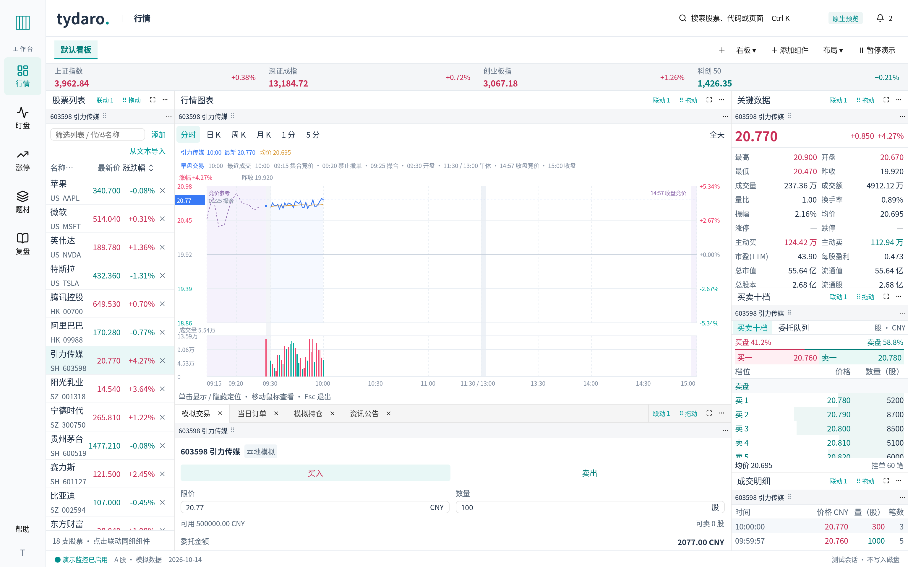
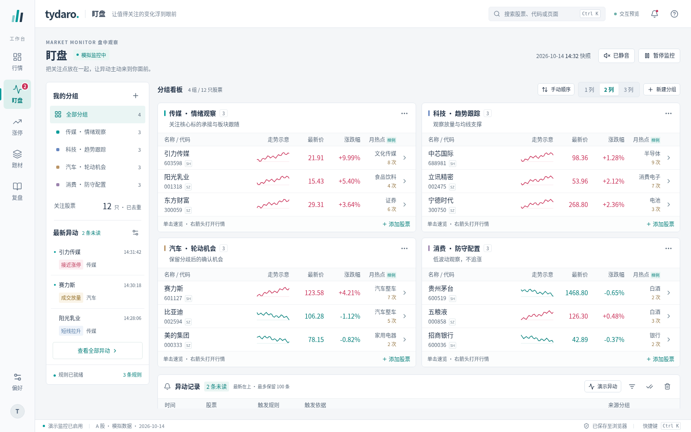

# Tydaro

使用 **Rust + GPUI** 构建的原生股票工作台。当前集中开发和验收 Windows 版本，参考专业行情终端的信息密度，通过可组合面板实现自定义布局。功能完善后再处理跨平台；已有 Linux 代码和构建资料保留，相关 CI 与验收暂停。

当前是前端预览版：启动直接进入工作区，行情、资讯、订单和持仓均使用本地模拟数据，无需登录。没有行情后端、券商连接或真实交易功能，CLI 与后端接入留待后续阶段。



## 五页原生工作台

行情、盯盘、涨停、题材、复盘共用浅色与青绿色外壳、导航、搜索和状态反馈。盯盘支持独立分组与演示异动；涨停支持跨日资料与 AND 筛选；题材展示周期证据和截止日联动；复盘支持按日预案、独立草稿、方法词库、人工记录及原生阅读窗口。资料可经确认加入指定分组或引用为草稿，保留来源日期与依据。

新业务数据保存到独立的 `desktop.json`，原有行情看板与 `workspace.json` 继续兼容。研究算法与行情仍为本地样例，新研究页面采用任务布局。能力范围、截图和验证入口见 [GPUI 实现说明](docs/native-design.md)。

## 桌面视觉设计预览

另有独立的 [React 交互样机](design-preview/README.md)，保留五页设计对照；原生应用已使用 GPUI 复刻主要页面与操作。构建后可下载并离线打开 `design-preview/dist/tydaro-preview.html`。设计依据和原生映射见 [GPUI 设计交接](docs/design-preview.md)。

基础样式在 [GPUI 原生组件实验室](docs/component-gallery.md) 中比较：十类基础组件，每类提供三种结构与交互方案，可在主窗口左侧「组件库」中打开，也可用 `cargo run --locked --bin tydaro -- --gallery` 独立启动。各方案保持同色系，先确认形态与操作，再决定整体风格；尚未替换业务页面控件。



## 第一版工作区

行情页顶部是可自定义的看板栏，参考通达信版面的横向切换方式。每个看板独立搭配组件、停靠布局和浮窗；可以从空白看板开始，也可以使用默认行情、双图布局或复制已有看板。默认页面为左侧股票列表、中间图表及交易标签、右侧报价与盘口。

| 面板 | 当前交互 |
| --- | --- |
| 股票列表 | 每组件一个独立分组，支持改名、增删股票、文本批量导入、搜索、排序与选股联动 |
| 行情图表 | A 股当日固定时轴分时、竞价与午休节点、多周期 K 线、十字线与吸附数据卡、日 K 双击历史分时、K 线缩放和平移 |
| 关键数据 | 双列显示开高低收、量比、换手、主动买卖、股本及估值等模拟字段 |
| 买卖十档 | 十档买卖价格与数量、深度条，以及委托队列切换 |
| 成交明细 / 逐笔成交 | 成交时间、价格、数量、笔数，以及逐笔金额、买卖单金额和大单筛选 |
| 委托明细 | 挂单与撤单双栏，支持金额、数量和买卖方向筛选 |
| 资讯公告 | 本地资讯示例与内容查看 |
| 模拟交易 / 当日订单 / 模拟持仓 | 本地委托、撤单及模拟状态，不发送实际交易 |

模拟账户和成交记录仅在当前会话中保留，重启后恢复示例账户；组件表单和图表视口随布局保存。

组件库目前有 11 类组件。行情统一由确定性的模拟时钟驱动，支持暂停；盘口委托、成交明细、逐笔成交与关键数据使用一致的模拟快照。截图参考落实为布局和字段组织，配色沿用项目现有浅色方案。美股/港股不适用的固定涨跌停字段显示为 `—`，数量以股计，不把 A 股的交易规则套到其他市场。

各组件的布局、字段和操作截图见 [组件说明](docs/components.md)。

分时图固定显示当天完整时轴，尚未交易的右侧留白，成交量和均价与价格使用相同时间位置。A 股单独显示开盘竞价，上午 09:30–11:30 与下午 13:00–15:00 在午休处分界，14:57 起标明收盘竞价；15:00 后保留全天曲线。新默认看板选中引力传媒，已有看板的选股与成员保持原样，可通过“添加”或文本导入加入 A 股样例。

分时图单击显示十字线和左右吸附的数据卡，移动鼠标查看对应分钟，再次单击一起隐藏。卡片显示时间、最新价、涨跌幅、累计均价及分钟成交量/额，历史分时同样支持。

日 K 单击进入数据定位，移动鼠标或按左右键查看各根蜡烛；详情卡自动吸附到十字线另一侧，按 Esc 退出定位。双击某根日 K 会打开该交易日的模拟分时，可用上一日/下一日按钮或 PageUp/PageDown 翻日。历史查看窗口保留打开时的数据，不改变主图的股票与缩放；使用图表工具栏“复位”恢复视口。

股票联动组用于同步股票列表、图表、报价等面板当前选择的股票，不共享列表成员。可以同时摆放“科技股”“港股观察”等不同列表，同一股票也可出现在多个列表中。行情图提供周期、均线、成交量和缩放，不包含“诊股、画线、工具”入口。

股票列表的“从文本导入”支持粘贴代码/名称及读取 TXT、CSV 文本，自动预览可添加、已有、重复与目录未收录项目。确认后只向当前分组追加匹配股票；当前目录包含原有六只美港股和十二只 A 股模拟样例，已有列表成员保持原样。

## 看板与自定义布局

- **看板选择**：点击顶部名称切换，支持新建、复制、重命名、左右排序和删除确认；看板较多时可从管理菜单直接选择。
- **独立布局**：每个看板保存自己的股票、图表周期、视口、表单、组件组合和浮窗；切换后恢复原样。股票联动和布局撤销只作用于当前看板。
- **窗口内停靠**：拖动标签调整顺序；拖到目标面板的上、下、左、右进行分割，拖到中央合并标签；拖动分隔线调整比例。
- **新增即浮窗**：“添加组件”和“复制为独立组件”默认创建并聚焦独立窗口，按组件类型设置大小，方便立即找到新组件。新组件沿用来源窗口的联动股票；已有面板仍可单独弹出。
- **重新插入**：浮窗组件的股票标题旁点击“插入面板”，选择目标组件，再选择左、右、上、下或合并标签。可以选其他窗口和非活动标签；移入成功后空浮窗自动关闭。源或目标布局已锁定时，需要先解锁。
- **跨窗口拖动**：拖动组件内部的股票标题区域或 `⠿` 拖柄，根据预览四向插入或中央合并。普通标签拖拽负责当前窗口内布局；操作系统标题栏负责移动整个窗口。单组件浮窗不会遮挡其后工作区的停靠命中。
- **面板状态**：移动时保留股票、周期和视口等状态，复制则创建独立实例。
- **组件改名**：组件菜单支持重命名，标签及独立窗口标题同步更新；清空名称可恢复默认类型名。名字和股票列表成员随看板保存，复制后可以独立修改。
- **关闭组件**：关闭独立窗口会移除其中全部组件，不会自动插回面板；误关可撤销布局。关闭主窗口会保存全部看板并退出，保留其余浮窗。
- **工作区管理**：保存和恢复布局、使用布局模板、锁定布局及撤销布局操作。

看板的使用、保存和迁移说明见 [自定义看板](docs/boards.md)。旧布局会自动成为“默认看板”，重启后恢复全部看板及最后选中的看板。行情演示时钟、暂停状态和模拟账户由所有看板共享。

当前跨窗口自由拖拽在 Windows 上开发和验收。保留的 Linux X11/Wayland 实现留待跨平台阶段重新验证；Wayland 不提供所需全局坐标，现有设计通过“插入面板”、弹出/返回和窗口内停靠完成布局调整。

布局存放在 Windows 的 `%LOCALAPPDATA%\Tydaro`，或 Linux 的 `$XDG_CONFIG_HOME/tydaro`（默认 `~/.config/tydaro`）。可通过 `TYDARO_DATA_DIR` 指定独立目录，方便测试不同工作区。存储包含版本和校验，保留之前的有效备份及无法读取的旧文件。

跨窗口坐标和停靠逻辑有模型测试；多显示器、混合 DPI、Windows 输入法和真实桌面拖拽仍需在 Windows 上进行人工验收，不能由自动交互测试或其他平台的旧验证结果代替。

## 下载 Windows 构建

打开本仓库的 **Actions → Desktop build → 已成功完成的对应提交 → Artifacts**，下载 `tydaro-windows-x86_64-<commit>`。解压 artifact，再解开内部版本 ZIP，运行 `tydaro.exe`。

ZIP 包含程序、构建信息和使用说明，旁边提供 SHA-256 校验文件。这是未签名的可解压预览版；Windows 10/11 x64 为目标运行环境，部分系统需要 Microsoft Visual C++ x64 Redistributable。Actions 产物保留 14 天。

## 本地开发

这是由 AI 与维护者持续协作的项目。开始任务先读 [AGENTS.md](AGENTS.md) 和 [贡献规范](CONTRIBUTING.md)，持续使用 **`codex/dev`** 开发。日常小功能和修复按项提交、推送后自动构建，累积一批相关功能再按用户要求创建阶段 PR，无需每次构建都开 PR 或新建分支。经用户授权后通过 merge commit 合入 `main`，保留开发分支及提交历史；禁止在 `main` 直接开发、提交或推送。首次克隆后运行 `git config --local core.hooksPath .githooks` 启用本地分支保护（已有自定义 hooks 时先整合）。

开发入口：[开发与交接](docs/development.md) · [架构与状态约束](docs/architecture.md) · [构建与 CI](docs/build.md)。

后续产品设计：[五页研究工作台方案](docs/product-plan.md) · [题材赚钱效应与候选规则](docs/theme-research-spec.md) · [实施与验收计划](docs/delivery-plan.md)。当前为待确认方案，新增研究、候选和行情接入能力尚未实现。

仓库固定使用 **Rust 1.96.0 stable** 和 `Cargo.lock`，不需要最新 Rust。rustup 会根据 `rust-toolchain.toml` 选择工具链，不影响机器的全局默认版本。

Rust 版本下限也受 GPUI 和其他依赖影响。当前锁定依赖中有包要求至少 Rust 1.92；本项目选择 1.96 作为构建基线，不宣称更低版本已经得到验证。降级或升级都应重新运行完整构建和测试。

Windows 先安装 Visual Studio 2022 Build Tools 的 C++ 桌面开发组件、Windows SDK 以及 rustup，然后运行：

```powershell
rustup show active-toolchain
./scripts/windows-sdk.ps1
cargo run --locked --bin tydaro
```

Linux 构建说明保留在[后续跨平台参考](docs/build.md#linux-开发与验证)，当前不作为开发或交付要求。

验证命令：

```bash
cargo fmt --all -- --check
cargo test --locked --workspace --all-targets
```

Windows 通过 `--architecture-smoke-test` 和 `--gallery-smoke-test` 验证原生状态与交互。锁定 GPUI 后端不支持 Windows 离屏像素渲染，画面、DPI 和输入法需实机检查。SDK、完整验证与打包命令见 [docs/build.md](docs/build.md)。

## CI 与目录

`codex/dev` 和 `main` 推送、Pull Request、手动触发均运行 [Desktop build](.github/workflows/build.yml)，无需先创建 PR。已有对应开放 PR 且可合并时，由 PR 的合并提交验证承担原生构建，避免同时重复编译；具体条件见[构建说明](docs/build.md#触发与加速策略)。所有原生工作流任务使用 Windows runner：仓库检查后并行执行独立 core 检查，以及 Release Clippy、完整 workspace 测试、原生状态/交互回归和生产构建打包。纯文档修改只运行仓库检查，手动触发始终完整构建。最终 `CI` 汇总 `checks`、`core`、`windows`，可作为合并所需状态检查。正式编译使用锁文件，发行程序不启用 `test-support`，工作流不自动发布 GitHub Release。

| 路径 | 职责 |
| --- | --- |
| `crates/tydaro-core/` | 独立业务模型、命令、文档契约、研究规则、模拟行情与文本解析 |
| `crates/tydaro-ui/` | 业务页和 Gallery 共用的原生基础组件与主题 |
| `src/app/` | 应用组装、运行时、五页外壳、业务状态适配及页面视觉规则 |
| `src/workspace/` | 唯一 Session、窗口、Dock、看板、联动、迁移及保存调度 |
| `src/panels/` | 各类行情面板、模拟账本、内容快照、图表及历史窗口 |
| `src/pages/` | 盯盘、涨停、题材和复盘；页面内分离编辑、查询、绘制与阅读窗口 |
| `src/adapters/` | 桌面业务与布局文件 IO、串行写入、图表数据源适配 |
| `src/gallery/` | 原生基础组件的三方案展示、样例状态及设计选择保存 |
| `src/test_support/` | 测试临时目录和按功能组织的原生交互回归驱动 |

根 `src/main.rs` 保留程序入口。模块只导出调用所需接口，内部状态与实现子模块保持私有；单测和原生内部断言分别放在所属模块的 `tests.rs`、`test_support.rs`。具体边界与测试归属见[架构说明](docs/architecture.md#模块职责)。目录调整不改变现有文件格式或窗口身份规则。

当前重点是前端工作区。真实数据源、后端服务、命令行工具、更多图表指标、签名安装包等按后续阶段推进。

## 开源依赖

界面使用 [GPUI Kit](https://github.com/longbridge/gpui-kit) 及其配套的 [GPUI Component](https://github.com/longbridge/gpui-kit/tree/main/crates/ui)，底层为 [GPUI](https://www.gpui.rs/)。项目采用 [MIT License](LICENSE)；各依赖遵循其各自的许可证。
