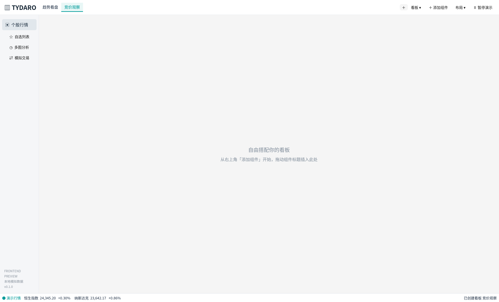

# 自定义看板

行情页顶部使用横向看板标签，参考通达信“版面”的选择方式，沿用 Tydaro 的浅色配色。一个看板是一套独立的组件组合：可以用来做个股看盘、多图对比、盘口观察等，名称和布局由用户决定。

## 创建和切换

点击顶部看板名称切换。点击新增入口，可以从空白、默认行情或双图布局开始；输入名称并确认后立即进入新看板。也可以复制当前看板，保留组件内容并得到独立副本。

看板管理菜单支持重命名、向左/向右调整顺序及删除，也列出全部看板供直接选择。名称最多 24 个字符，同名看板不能重复创建；最多保留 16 个看板。删除需要确认，最后一个看板不能删除。

## 自由搭配组件

在当前看板中点击“添加组件”，新组件默认以独立窗口打开。通过组件内部股票标题拖动，或“插入面板”菜单，把它插入当前看板的上、下、左、右或合并为标签。分割比例、标签顺序和浮窗都可自由调整，具体见[组件说明](components.md)。

切换看板时，原看板的浮窗会随其收起，回来后按原布局恢复。每个看板分别保留股票选择、图表周期和视口、输入表单、筛选条件及布局锁定。股票联动只在当前看板生效；不同看板可以观察不同股票。同一会话的布局撤销记录也分别维护。

“默认行情布局”“双图对比布局”和保存/加载模板只调整当前看板。行情演示时钟、暂停状态和模拟账户由所有看板共享。

## 保存与旧布局

应用自动保存全部看板，重启恢复看板顺序、内容以及最后选中的看板。旧版的单个工作区会自动成为“默认看板”，原有组件、浮窗和内容完整保留；首次保存新格式时会保留旧文件备份。

看板保存位置与原工作区相同，详见 [README](../README.md)。当前仍使用本地模拟行情，无需登录。
