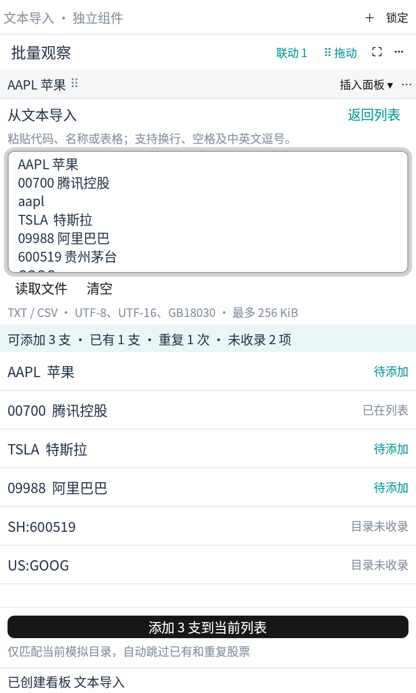
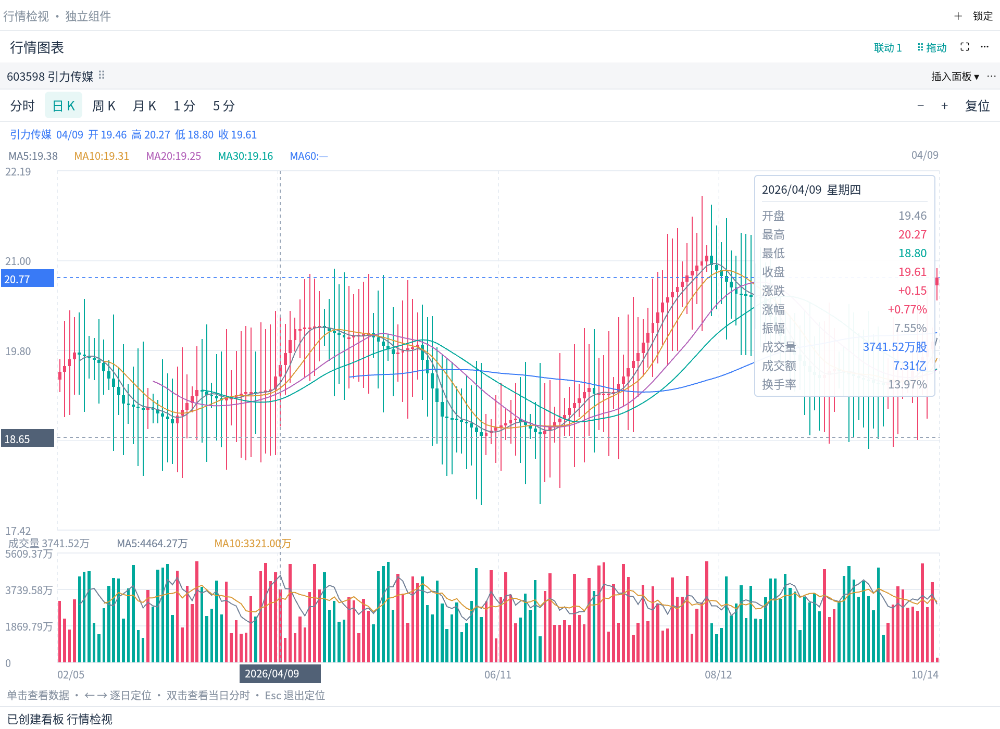
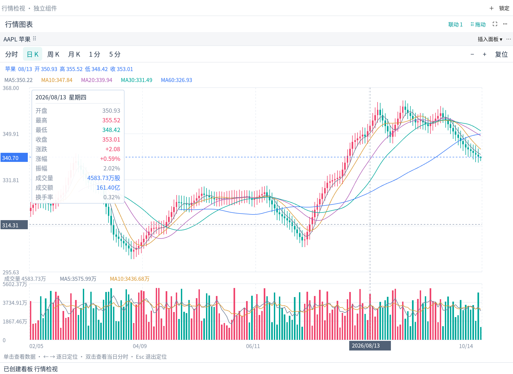
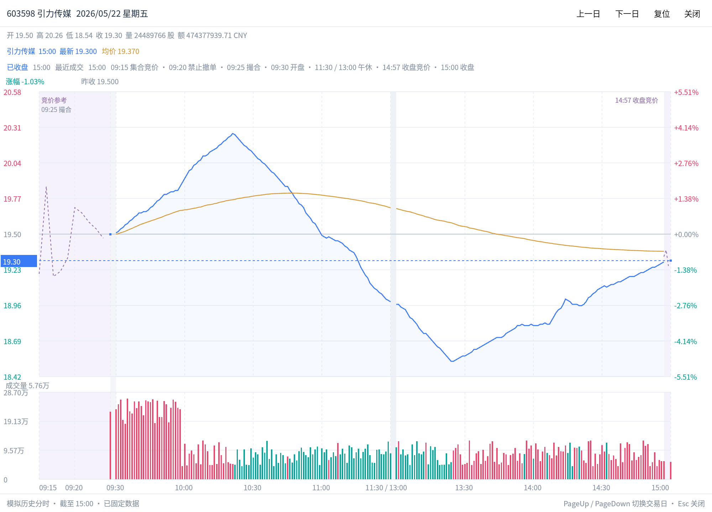

# 行情组件

组件按参考图的信息布局组织，沿用 Tydaro 的白色、浅灰、青色与玫红配色。下面是应用实际渲染的模拟数据截图；当前不连接实时行情或券商。

行情页顶部通过[自定义看板](boards.md)管理不同组件组合。下面的添加、停靠、联动和模板操作都作用于当前看板。

## 窗口与重新插入

从“添加组件”选择组件后，会打开并聚焦独立窗口。复制组件也会新开窗口，保留原组件内容并分配独立身份。

回插可使用两种方式：

1. 拖动组件内部的股票标题区域或 `⠿` 拖柄，进入目标面板后按预览选择上、下、左、右或中央合并标签。
2. 点击浮窗中的“插入面板”，先选目标组件，再选方向。目标也可以是另一个窗口中的非活动标签。Wayland 使用此方式回插。

操作系统标题栏用于移动整个窗口。移入成功后，空浮窗自动关闭；股票、表单、筛选和图表视口随原组件保留。源窗口或目标窗口锁定时先解锁。

点击独立窗口的系统关闭按钮或按 Alt+F4，表示移除该窗口及其中全部组件（包括未选中的标签），不会插回主面板，也不受布局锁定影响。误关可在当前会话通过“布局 → 撤销布局修改”恢复；需要回插时使用拖动、“插入面板”或返回主窗口。关闭主窗口则保存全部看板并退出应用，保留其余浮窗供下次启动恢复。

## 组件名称与股票列表

原“自选列表”改称“股票列表”。每个组件是一份独立的股票分组，可以分别命名为“科技股”“港股观察”等，并在看板中同时展示；同一只股票可以属于多个列表。

组件菜单中的“重命名组件”可修改显示名，确认后组件标签、独立窗口标题及插入目标名称同步更新。名称最多 32 个字符；清空后确认会恢复默认类型名。其他类型的组件也支持改名，名称只影响显示，不改变组件类型或联动规则。

列表中的搜索只筛选当前成员；点击“添加”进入股票目录，可以按代码或名称搜索并添加，已添加的股票不会重复加入。点击行内移除按钮仅把股票移出当前列表，不切换其他面板的股票，也不影响模拟账户。可以保留空列表，之后再添加成员。

当前目录是前端已有的六只模拟股票：AAPL、MSFT、NVDA、TSLA、00700、09988，尚未接入全市场搜索。旧布局及新建列表沿用六只示例股票；用户清空的列表在保存和重启后仍为空。

各列表分别保存成员、搜索条件和排序。联动组只同步当前选中的股票，不会自动增删列表成员；复制列表会得到可独立编辑的副本。名称和成员在移动、回插、看板切换、模板和重启后保留，布局撤销也不会倒退仍存活组件的当前名称或成员。


### 从文本批量导入

点击列表中的“从文本导入”，或从“添加”目录进入同名入口。粘贴多行代码/名称后自动显示识别结果，也可以点击“读取文件”打开 TXT、CSV 文本。支持 UTF-8（含 BOM）、带 BOM 的 UTF-16 LE/BE、GB18030（兼容常见 GBK 导出）。文件和解码后文本最多 256 KiB，一次最多识别 5000 条候选；超限或无效编码会显示错误，不会部分导入。

```text
AAPL 苹果
MSFT, TSLA
00700 腾讯控股
9988.HK
SH600519 贵州茅台
```

识别支持大小写代码、完整中文名称及常用别名，空格、制表符、换行和中英文逗号/分号可作为分隔。`AAPL`、`US:AAPL`、`AAPL.US` 等价；`00700`、`HK700`、`700.HK` 等价，裸 `700` 不当作港股代码。明确的市场标识不会跨市场匹配。可识别 A 股、通达信市场前缀等代码形式，但目录外证券（如示例中的 `SH:600519`）只列出“目录未收录”，不会新增模拟证券。

预览分别统计可添加、列表已有、文本重复与未收录项目。同一行相邻的代码和对应名称算一条股票；批量确认按首次出现顺序追加，已有股票和重复项自动跳过，不覆盖现有成员。返回列表或清空输入不会添加股票；确认后显示实际添加数量，再次确认不会重复添加。原有搜索和排序保持不变，如新增股票不符合当前搜索条件，清空列表筛选即可查看。小尺寸窗口中正文可整体滚动，标题和底部确认按钮保持可见。

粘贴行情表格时建议每行一只股票，后接名称与行情列；价格、百分比和日期不会被拆成代码。明确行情数值后的未知裸数字按数据列处理；在同一行混入另一只股票时，使用市场前缀（如 `SH600519`）或换行/分号可避免歧义。未收录项目超过 200 条时只展示前 200 条，统计仍包含全部结果。当前不解析通达信二进制板块文件。



## 关键数据

双列排列开高低收、成交量与金额、量比与换手、振幅与均价、主动买卖、估值及股本。价格和金额随股票标明 USD / HKD，数量以股计；美股和港股没有本示例所指的固定涨跌停，显示为 `—`。


## 买卖十档

显示十档买卖价格、数量、深度条、买卖占比及最优报价。可切换“委托队列”查看各档模拟挂单；高度不足时滚动查看剩余档位。


## 成交明细与逐笔成交

成交明细显示时间、价格、股数和笔数。逐笔成交展开成交金额及买卖单金额，以背景条辅助比较，并提供金额不少于 10 万的大单筛选。两者来自同一批模拟成交，逐笔数量与金额可汇总回成交明细。


## 委托明细

左侧挂单、右侧撤单，展示时间、方向、价格、数量、金额及原委托时间。金额上下限以当前币种的万元计，可叠加数量和买卖方向筛选。它展示市场模拟委托，与“当日订单”中的本地模拟账户委托分别管理。


## 行情图表

提供分时、日 K、周 K、月 K、1 分和 5 分 K 线。分时显示昨收基准、涨跌幅和均价；K 线显示 MA5 / 10 / 20 / 30 / 60，下方成交量显示 MA5 / 10。支持滚轮缩放、拖动平移，通过工具栏“复位”恢复视口。不包含“诊股、画线、工具”入口。


单击图内进入定位状态，十字虚线贯穿价格图与成交量图，坐标轴显示定位价格/成交量和日期。继续移动鼠标可检查其他蜡烛，移出图表后保留最后定位；左右方向键逐根移动，Esc 退出。缩放和平移后仍按所选蜡烛的实际日期定位。

K 线详情卡吸附到十字线另一侧：左侧定位时卡片靠右，右侧定位时靠左。日 K 显示日期与星期、开高低收、涨跌、涨幅、振幅、成交量、成交额和换手率，均线读数同时跟随定位。较矮图表中的卡片可滚动，滚动卡片不会改变图表缩放。其他 K 线周期尚无对应成交额/换手数据时显示 `—`。





双击日 K 会打开该交易日的独立历史分时窗口，保留主图的股票、周期和缩放。窗口显示当天完整的可用分时、均价与成交量，提供上一日/下一日按钮以及 PageUp/PageDown，历史边界停止翻日。重复双击同一图表会复用其查看窗口；点击“关闭”、系统关闭按钮或 Esc 结束查看。源组件被移除、跨窗重建或切换看板时，所属临时查看窗口随之关闭；工作区保存只记录原图表。

历史查看使用固定快照。已完成交易日的分时开高低收、成交量与对应日 K 一致，成交额和均价来自同一组分钟数据；最新模拟日仅展示打开时已生成的时段。当前数据以 2026-10-14 为固定演示日，跳过周末，所有股票沿用 09:30–16:00 的合成时钟，不代表真实交易所日历、午休或真实历史行情。



完整工作区与分时图见 [README](../README.md)。面板筛选和图表视口随布局保存；行情、估值、时段及交易记录均为前端演示，不代表真实市场。
