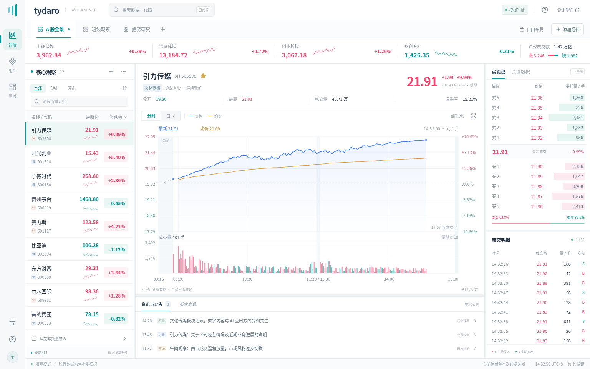

# 浅色行情工作台设计与 GPUI 交接

本方案通过独立的 [React 预览](../design-preview/README.md) 验证视觉与主要操作路径。目标是适合长期看盘的现代 Windows 桌面终端：密度足够、重点明确、布局可组合，并能用现有 GPUI 基础复刻。Rust 主程序、行情模型和布局存储没有因预览而替换。

## 设计取舍

**以任务组织工作区。** 顶部看板对应「全景观察」「短线观察」「趋势研究」等工作任务，每个看板保留自己的分组、选股和布局。左侧窄导航负责工作台级入口，避免占用行情横向空间。组件管理与股票管理分别放在相关位置，减少同层按钮竞争。

**先识别股票，再判断行情，最后查证细节。** 左侧是分组列表，中间先展示名称、价格和关键摘要，再把最大连续空间留给图表；右侧提供盘口与成交细节，下方承接资讯。列表数字右对齐、使用等宽数字，名称和代码分层，选中项通过浅青背景与细边标识。常规与紧凑密度服务不同信息量，不用巨大的数据卡占据工作区。

**沿用当前颜色，让装饰退到背景。** 白色面板、浅灰框架和细线建立区域；品牌青色表示选中和主要操作，涨跌色主要服务行情。仅浮层使用明显阴影，圆角较小，图标采用简单矢量线条。无需磨砂玻璃、复杂网页滤镜或持续动画。图表不加入诊股、画线、工具入口。

**图表遵循 A 股日内结构。** 分时固定全天时轴，区分开盘竞价、09:30 开盘、11:30–13:00 午休和 14:57 收盘竞价；未发生的时间保留空白。单击开启十字线和另一侧的数据卡，再次单击关闭；日 K 双击打开历史分时。信息卡避免遮挡当前观察位置，检视状态与普通 hover 分离。

**组件操作可发现、可恢复。** 新组件先出现浮窗，提供显式插入入口；关闭表示删除，可即时撤销。分栏拖柄、选中态、禁用态和快捷键具有可见反馈。对话框支持焦点进入、Tab 循环与 Esc 关闭，常用图标有文字提示；动效遵循减少动画偏好。

## 设计参数

| 语义 | 当前原生基准 / 预览方向 |
| --- | --- |
| 正文 | `#233348` |
| 次要文字 | `#85909F`；关键数值使用正文或涨跌色 |
| 边线 / 框架 | `#E8ECF0` / `#F5F6F8`，面板白色 |
| 品牌与操作 | `#009B9A`，选中背景为低饱和浅青 |
| 上涨 / 下跌 | `#EF4770` / 青绿色；同时保留正负号、数值和买卖方向 |
| 分时价格 / 均价 | `#397AF6` / `#D99935` |
| 字体 | 系统中文无衬线；GPUI 现用 Windows Microsoft YaHei UI、Linux Noto Sans CJK SC |
| 密度 | 原生字体基准 13 px，辅助信息分级缩小；桌面优先，支持紧凑行距 |
| 表面 | 细边框、小圆角，阴影限菜单、对话框和浮窗 |

React 数值与布局是视觉参考，不要求机械复制每个 CSS 像素。原生字体度量、窗口装饰和 DPI 不同，复刻时优先保证内容完整、列对齐与命中区域，再调整间距。

## 原生实现映射

| 预览部分 | GPUI 实现与现有模块 |
| --- | --- |
| 应用框架、窄导航、分栏 | `workspace.rs` 使用 `div`、Flex、尺寸约束与统一样式；实际分栏继续由 DockArea 管理 |
| 看板标签与新增入口 | `board_bar.rs` 显示交互，`boards.rs` 维护身份、名称和快照；沿用当前切换及回滚协议 |
| 股票列表、分组与盘口 | `contents.rs` 的原生控件；列宽与数字对齐显式定义，大数据列表使用虚拟化，避免每次 tick 重建全部行 |
| 股票和组件身份、周期 | `model.rs` 保留持久 ID、`custom_name`、每组件周期和联动组，不照搬网页按看板共享周期的简化状态 |
| 图表与数据卡 | `chart.rs` 通过 `canvas` / `PathBuilder` 绘制线、K 线和量柱；卡片用普通 GPUI 元素覆盖，复用现有全天时间映射与定位逻辑 |
| 历史分时 | `history.rs` 创建原生临时窗口；`market.rs` 保证所选日 OHLC 和分钟量额一致，不采用网页的静态历史样例 |
| 组件库与添加浮窗 | 原生 Button、PopupMenu、输入与对话框；`workspace.rs` 按组件类型创建系统窗口 |
| 插入、弹出与删除 | `transfer.rs` 返回迁移意图，`workspace.rs` 执行窗口间重建与撤销；保留关闭即删除的规则 |
| 文本导入 | `stock_import.rs` 保持有界解析、多编码文件读取、识别和去重；预览解析器仅用于交互演示 |
| 持久化 | `storage.rs`、`boards.rs` 沿用版本化布局和校验，不把 React 对象直接当原生存储格式 |
| 图标与反馈 | 简单 SVG 资源或原生图标，颜色与边框状态可直接实现；无需嵌入 WebView |

GPUI 已具备这些基础能力。后续工作主要是整理统一的颜色、尺寸、排版与图标资源，再逐块替换外观；窗口身份、业务内容快照和市场逻辑继续沿用现有实现。

## 样机与原生边界

预览内的浮窗可拖动标题、使用浏览器 CSS `resize` 调整大小，并从菜单向主图区域四向插入。它没有系统窗口、完整 DockArea、任意面板目标命中、标签合并、跨显示器坐标或原生焦点迁移。其停靠树只是展示组合效果，不应取代现有原生迁移协议。

所有状态保存在页面内存，刷新即恢复初始值；不读取 Rust 布局。预览内有 12 只独立 A 股样例，原生仍保持既有 8 只目录。左侧主列表提供完整的分组管理流程，附加列表仅展示独立成员快照与选股。预览按看板共享选股及图表周期，原生每个实例的周期和联动组约束仍然有效。

所有行情、指数、资讯和历史数据都是静态模拟。历史弹窗只演示交互链路，其曲线不对应所选日 K 的 OHLC、成交量或成交额；不能把预览当作原生行情计算测试。盘口内容也是排版样例，接入原生时应使用 `market.rs` 的完整档位及一致数据。

预览针对桌面宽屏，不设计手机端交易界面。字体、最小面板宽度、长名称、键盘路径、混合 DPI 和真实窗口行为需要在 Windows 原生版本单独验收；浏览器截图或测试通过不能替代这些检查。

## 复刻顺序与验收

1. 抽取统一样式参数，先更新应用框架、看板栏和面板标题；保留当前存储格式与组件身份。
2. 更新股票列表、报价摘要、盘口和成交表格，检查紧凑模式、窄面板、空列表及长名称。
3. 调整原生图表视觉，保留现有竞价、午休、十字线、历史聚合与键盘回归；不要用网页假数据覆盖原生逻辑。
4. 更新组件库与浮窗外观，验证添加、关闭、撤销、重新插入、切看板和重启恢复。
5. 在 Windows 100%、125%、150% 缩放及混合 DPI 多屏下检查字体、拖动、焦点和窗口恢复；Linux 保持构建与现有回归。

预览使用 Node.js 24，在 `design-preview/` 运行 `npm ci`、`npm run dev` 或 `npm run build`。构建生成可双击离线打开的 `dist/tydaro-preview.html`。浏览器检查使用 `CHROMIUM_PATH=/usr/bin/chromium npm run test:ui`；省略环境变量时使用已安装的 Playwright Chromium。具体启动和体验路径见 [预览 README](../design-preview/README.md)，验证结果以实际执行记录为准。

### 本次验证

锁文件安装、TypeScript 与生产构建通过。Chromium 生产模式通过 8 组交互场景，开发 StrictMode 通过 7 组；两轮没有页面 JavaScript 错误。检查涵盖 1280×800、1536×960、1920×1080 的完整图表轴，以及选股联动、看板隔离、十字线切换、日 K 历史弹窗、导入去重、浮窗关闭/撤销/插入、布局锁和搜索焦点。

独立 HTML 已验证不请求额外脚本、样式或图片；当前云浏览器管理员策略禁止 `file://`，因此此环境通过 HTTP 验证同一内联文件，不将本地文件打开记为通过。报告输出在 `design-preview/artifacts/summary.json` 与 `summary-dev.json`，工作流上传截图和报告。

CI 路径分类的 22 项测试与 Git hooks 检查通过。本次未修改 Rust 源码、工具链或 Cargo 依赖，未在本地重复执行原生构建；Windows 原生外观、跨窗口与 DPI 验收留在复刻阶段。
