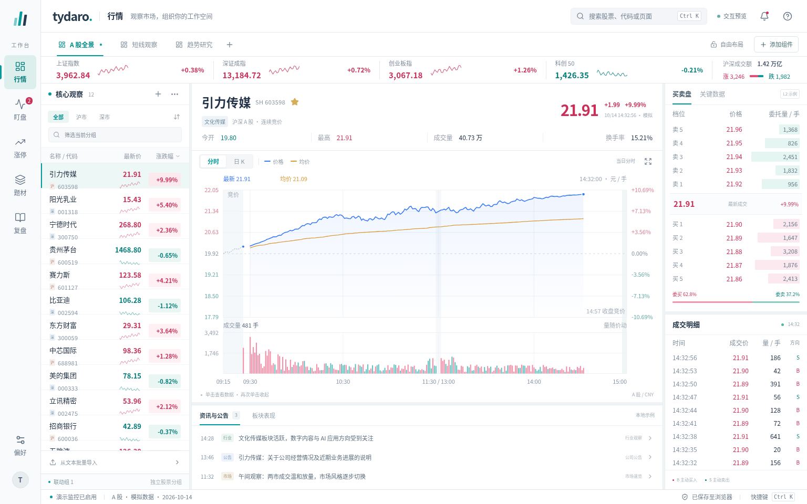

# 统一研究工作台设计与 GPUI 交接

当前基础样式在 [GPUI 原生组件实验室](component-gallery.md) 中逐类比较，每类提供三种结构和交互方案。React 组件画廊及上一轮五页预览改动已撤回，不作为当前风格方案。

盯盘双表、涨停三分区、题材证据与人工判断、模式候选和次日预案仍是 [五页产品方案](product-plan.md) 中的规划。本页后续流程描述保留为设计交接参考，不代表这些规划已经在当前 React 或 GPUI 中实施；下方截图用于历史设计对照。

上一版方案先通过独立的 [React 预览](../design-preview/README.md) 验证五页的信息架构、浅色视觉和操作路径，再在 Rust / GPUI 主程序中复刻五页前端。原生版本沿用已有行情、图表和 Dock 布局能力，新增独立业务文档，不嵌入 WebView、不替换用户的旧看板数据。仓库中的 React 基线保留为历史设计对照；它与原生版本均不表示已完整实现附件 42 的旧应用算法、数据库兼容或真实行情。

以下为 React 设计截图，不能作为原生运行或 Windows 实机验证证据：[行情](design-unified/market.png) · [盯盘](design-unified/watch.png) · [涨停](design-unified/limit.png) · [题材](design-unified/theme.png) · [复盘](design-unified/journal.png)。

## 统一的部分与保留差异的部分

五页共用左侧导航、全局搜索、正文层级、按钮、表格和状态反馈。沿用白色面板、浅灰框架、青色操作和涨红跌绿，不因参考附件的暗色建议改变已确认的项目方向。数据色与选中状态分开：选择通过浅青底、边线或标记表达，收益高亮仍保留业务含义。

页面布局由任务决定，不把所有内容套进同一种仪表盘。行情需要大图表；盯盘需要多组扫描；涨停需要跨日横向对照；题材需要对象—证据—联动；复盘需要长文本与稳定的结果区。页面标题和主要动作的位置统一，重要内容获得连续空间，次要细节放在页签、速览或编辑弹层中。

| 入口 | 后续拟调整布局 | 原生现状 |
| --- | --- | --- |
| 行情 | 左列表、中图表、右盘口；保留自定义看板与组件管理 | 保留已有布局与原生组件身份 |
| 盯盘 | 左集合导航、中独立双表、下预警；A 跟随选择，B 固定对照，预警区可调整高度和收起 | 仍为多组卡片，支持 1/2/3 列 |
| 涨停 | 左上多日矩阵、左下选中明细、右侧独立 AND 搜索；可调分割与收起搜索 | 仍为顶部条件、矩阵和下方结果 |
| 题材 | 左题材、中四类证据、右人工判断与次日候选入口；样本可展开，强势和主流分别确认 | 仍为周期证据与截止日联动 |
| 复盘 | 左模式候选、右独立草稿与次日预案/盘中记录；人工热点和手工收益收纳为辅助记录 | 仍为人工热点、当日预案和历史文档 |

「盯盘」与「行情」区分多股监控和单股研判。「看板」是行情中的布局容器，不是与业务页面并列的概念。React 和原生版本中，盯盘分组与行情股票列表都保持独立，改名或移除成员不会隐式修改另一页。

## 让操作顺手的设计

**看清再操作。** 列表名称和代码分层，价格/涨幅右对齐、使用等宽数字，正文与辅助信息分级。新版预览以 12–14 px 主体文字为主，辅助标签、代码和图表轴使用较小字号，关键结论不依赖小字。页面标题约 21 px。常规与紧凑密度保留两档，两行股票行留足高度；密度切换并非所有控件同倍率缩放。原生字号仍需结合 DPI 单独验收。

**减少往返与记忆。** `Ctrl/Cmd + K` 同时搜索股票和页面；研究中的股票可先打开个股速览，关闭后原筛选、选择和滚动仍在。需要深入分析时再打开行情。预案卡片同时展示触发与放弃/持仓条件，不要求为了对照来回切换买卖页签。

**保留观察位置。** 分时固定全天时轴，区分开盘竞价、09:30 开盘、11:30–13:00 午休和 14:57 收盘竞价，未来部分留白。单击开启十字线，移动定位，数据卡吸附到另一侧，减少遮挡当前点；再次单击关闭。日 K 双击进入历史分时流程。图表继续不提供诊股、画线、工具入口。

**动作和结果相邻。** 加入分组前展示新增/重复/目录外结果；保存状态在复盘和底栏常驻；错误在编辑或保存对象附近出现，不能只显示一个瞬间消失的成功提示。弹层支持键盘焦点、Tab 和 Esc；中文输入组合期间不抢占确认快捷键。模态编辑期间先完成或关闭弹窗，再使用全局搜索跳页，避免旧编辑快照覆盖跨页新增内容。少量动效遵循减少动画偏好。

**布局调整不伤害内容。** 行情新增组件先浮出，标题可拖动，显式插入菜单提供四个方向。关闭移除组件并允许撤销。复盘阅读浮窗共享当天业务内容，自己的位置和折叠只影响阅读视图。原生行情继续允许图表和列表等组合，复盘提供独立阅读窗口；新研究页面仍采用固定任务布局，尚未把预案纳入任意停靠。保存中的业务编辑流程保持完整上下文，不把相互依赖的输入框任意拆散。

预览最小框架为 1080×700 CSS 像素，面向桌面，不提供手机交易布局。字号、命中区域和分栏策略还需要在真实 Windows 字体与 DPI 下验收，浏览器像素不是原生尺寸的机械映射。

## 来源和日期保持可见

五页通过显式动作交换上下文，而不是共享一个会悄悄覆盖所有页面的全局日期。

1. 在涨停中选择日期和板块，筛选结果来自内置资料，不是实时全市场涨停池。
2. 「研究题材」定位样例对象；新版题材页显示请求截止日和实际快照日。当前仅提供 2026-10-14 收盘研究样例，更早日期不展示未来证据，更晚日期明确回退。梯队与收益样本各自标出观察范围，广度明确使用 10-13 历史截面。
3. 「加入盯盘」选择目标分组、预览去重后追加。未知代码不生成虚构证券。
4. 「引用为预案」显示资料日期，允许选择新的复盘业务日期；经个股速览再引用，也保留原资料日期、题材和依据；只带入股票、题材和依据，创建独立草稿。用户填写自己的买卖条件，不自动追加完成结果。
5. 盘中从盯盘异动查看股票，再回到预案补记观察。价格变化和文本预案之间没有自动交易或自动判定关系。
6. 新版题材页保存人工判断后进入复盘候选；“强势题材二板”只筛选研究源日的首板股票，按代码去重并保留排除原因。每只候选生成独立草稿，冻结题材判断与证据版本；填写触发和放弃条件后才加入次日预案。

人工热点、自动研究、股票分组是不同对象。人工热点最多保留最新 5 条；预览不会用题材结果覆盖它。手工买入收益不是账户核算数据，也不生成持仓、盈亏金额或绩效曲线。研究区的“累计次数”不是跨日去重后的独立股票数。

## React 预览实际保存什么

| 内容 | 当前范围 |
| --- | --- |
| 复盘按日预案、多个草稿、盘中记录 | 当前浏览器 `localStorage`，包含业务日期和记录身份 |
| 人工热点、买卖手法、手工买入记录 | 同一个复盘浏览器文档 |
| 行情看板、股票列表、浮窗与布局 | 本次会话；刷新重置，不读取原生布局 |
| 盯盘分组、排序、规则、异动与静音 | 本次会话；没有后台行情服务或真实声音 |
| 涨停内置资料增删改、研究筛选与选中 | 本次会话；不写 SQLite，不同步题材样例 |
| 题材人工判断、候选选择 | 本次会话；草稿中已经冻结的研究来源随复盘保存 |
| 活动页面、显示偏好、窗口位置 | 本次会话；默认启动进入行情，可用 `#watch` / `#limit` / `#theme` / `#journal` 指定预览入口 |

复盘使用 `tydaro.preview.journal.v2`，修改后 700 ms 防抖保存，也可立即保存；切换日期、关闭阅读浮窗和页面隐藏时尝试提交当前内容。成功写入后才显示已保存。浏览器禁止访问存储时转为仅会话模式；写入失败时保留内存并显示错误/重试。读取到损坏或不兼容数据时保留原值、禁止直接编辑，可重试读取或明确选择仅会话体验。

这不等同于原生事务存储：没有 SQLite 迁移、磁盘备份、跨浏览器/多标签页版本冲突处理，关闭浏览器也不能保证失败数据被保存。`file://` 的存储行为因浏览器不同；同一 HTML 用不同来源打开也不保证共享内容。样机应只用于演示，不作为正式复盘档案。

复盘校验已经用于交互：板块必填，至少一侧手法和触发条件完整，允许只写卖出计划；已填任一侧字段就需补齐该侧必要字段。不完整内容留草稿。新版研究候选还要求明确放弃买入条件，来源快照作为可选字段加入原有 `journal.v2`，旧记录缺少该字段仍可读取。买卖手法独立，删除选项不改历史文本。买入简介先取最近 10 笔再按收益排序；严格 `>10%` 高亮，同名人工热点按全量手工记录派生高亮。原生仍保持旧校验与文件格式，其保存与阅读窗口必须单独验证；两版都不代表旧数据库兼容已完成。

## 原生版本实际保存什么

原生使用平台配置目录中的 `desktop.json` schema `1`，也可用 `TYDARO_DATA_DIR` 隔离数据；它与浏览器 `localStorage` 不同步，也不迁移浏览器内容。详情见 [架构与状态约束](architecture.md#桌面业务持久化)。

| 内容 | 原生保存方式 |
| --- | --- |
| 行情看板、组件、内容和浮窗 | 原有 `workspace.json` schema `2`，单看板与模板继续使用原有格式 |
| 盯盘分组/成员、监控与静音、规则、异动 | 独立 `desktop.json`；异动最多保留 100 条，仍为本地演示 |
| 按日预案、独立草稿、盘中笔记 | `desktop.json`，稳定 ID 与业务日期，阅读窗口访问同一文档 |
| 人工热点、手法、手工买入记录 | 同一桌面业务文档，与研究算法和模拟交易账户分开 |
| 涨停资料已确认的增删改 | `desktop.json` 的研究子文档；不触发题材证据重算 |
| 活动页面 | `desktop.json`，启动恢复；页面筛选、列数、排序、选中和弹窗位置为临时视图状态 |

业务修改后 700 ms 防抖保存，主窗口退出前再尝试写入；保存成功才显示“已保存到本机”。读写限制 8 MiB，记录身份、日期、文本、数量和数值均校验。原子替换前把有效旧文件保留为 `.bak`；坏文件、未知版本、读取失败或保存期间检测到外部修改时停止覆盖，显示仅在内存的状态，不自动恢复备份。研究子文档无效时保留原 JSON 并暂停该页修改。保存失败不是成功，进程退出或崩溃可能丢失尚未落盘的内容。

原生保存是本地版本化文件服务，没有旧 SQLite 迁移、跨设备同步或多进程事务能力。布局撤销不会回滚研究编辑或复盘记录，关闭复盘阅读窗口也不会删除内容。

## 样机与原生的业务边界

两版涨停页的导入按钮都添加内置样例日；React 的编辑和整日删除只更新这页内存，原生把已确认修改存入独立桌面文档。它们都不是文件选择、SHA-256 去重、旧格式兼容解析或数据库事务。搜索支持字段文本的 AND 交集和取消条件，未完成附件中的日期范围、连续涨停、同日板块联动等全部查询语义。

题材页的四板对象、梯队、归属和关键词匹配是固定研究样例，日期控件筛选对象并展示样例截止日。涨停页导入/编辑/删除不触发题材重算；截止日变化也不代表执行了真实的联动算法。两页用于检验操作和解释方式，不作为算法对齐证据。

盯盘的走势、月热点和异动为样例；演示按钮根据当前启用规则生成一条演示事件，暂停阻止新增，静音只改变界面状态。没有真实行情轮询、15 秒采样计算、有效性检查、冷却/每日计次、声音队列或 Windows SAPI。附件中的完整规则及月热点统计仍需独立对齐，当前原生复刻同样保留演示边界，不能按 UI 文案反推已经具备业务实现。

React 预览拥有独立的 **12 只 A 股**目录；原生目录现为 **18 只，其中 12 只 A 股**，保留原有 4 只美股和 2 只港股，已有行情列表不自动追加股票。React 的行情关键摘要、盘口、图表分别使用演示数据，未校准量额聚合；浏览器历史分时只展示日 K 双击链路，不对应所选蜡烛的 OHLC、量额。原生继续使用 `market.rs` / `history.rs` 的统一行情及选中日聚合逻辑。预览按看板共享选股和图表周期；原生每组件周期、联动组和身份约束保持有效。行情附加列表只展示自己的成员快照，完整管理集中在主列表。

浏览器浮窗是同页面元素，支持标题拖动和 CSS `resize`。四向插入只拆分主图区域，没有系统置顶、完整 DockArea、任意目标命中、标签合并、跨显示器坐标或原生焦点迁移。两版新研究页面都使用稳定任务布局，没有任意面板停靠。React 复盘阅读浮窗是页面内元素；原生复盘阅读窗口是真实 GPUI 窗口，同进程共享业务文档并分别创建输入与焦点。

## 已实现的 GPUI 映射

| 设计部分 | 当前原生模块与边界 |
| --- | --- |
| 统一外壳、导航、搜索与视觉 | `desktop.rs`、`desktop_ui.rs` 使用 GPUI Flex、尺寸约束和原生控件，不嵌入 WebView |
| 看板和自由布局 | 继续使用 `board_bar.rs`、`boards.rs`、DockArea；`transfer.rs` 保留迁移意图和窗口重建协议 |
| 股票列表、盘口与成交 | 延续 `contents.rs`，调整浅色表格与文字层级；保留原有内容身份及列表管理 |
| 股票、组件与联动 | `model.rs` 继续保存持久 ID、`custom_name`、每组件周期和联动组；盯盘分组不合并用户旧列表 |
| 图表、左右数据卡 | `chart.rs` 使用原生绘图和 GPUI 数据卡，保留命中与 A 股全天时间映射 |
| 历史分时 | `history.rs` 与 `market.rs` 保留冻结快照及按所选日一致聚合的实现 |
| 盯盘 | `watch_page.rs` 提供分组、规则与演示异动；全局状态放在 `DesktopState`，没有真实监控或系统声音 |
| 涨停与题材 | `research_page.rs` 提供资料矩阵、AND 条件、编辑和证据展示；固定题材样例不等于已对齐完整旧算法 |
| 复盘及多窗口 | `journal_page.rs` 提供按日预案/草稿、输入校验、人工记录和独立阅读窗口；共享文档由 `desktop_state.rs` 管理 |
| 跨页动作 | `DesktopEvent` / `SourceContext` 携带来源、日期、股票与依据；`desktop.rs` 在显式确认后创建草稿或追加分组 |
| 新业务保存 | `desktop_state.rs` 保存独立 `desktop.json`，有 revision 防抖、字段校验、有效备份与失败保护；不是浏览器存储或 SQLite 迁移 |
| 文件导入与旧布局 | 股票文本继续由 `stock_import.rs` 有界处理；涨停旧格式兼容尚未实现，`storage.rs` 现有布局协议保持不变 |

共享业务状态不意味着跨原生窗口共享 InputState、FocusHandle 或布局实体。窗口独立创建输入与焦点，由应用命令更新同一文档；保存按文档 ID 与 revision，不按当时可见日期写入。

## 后续业务与验收

1. 对照五页设计继续验收原生中文长文本、表格、焦点和窄窗口。复用锁定工具链，不把网页像素机械换算成 Windows 字体和 DPI 下的尺寸。
2. 保持既有竞价、午休、十字线、历史聚合、组件关闭/撤销/插入和旧布局恢复回归；五页重构不能替换原生行情数据逻辑。
3. 对原生新增流程验证跨页来源、业务日期、分组去重、多日期独立草稿、仅卖出计划、按 ID 更新、10% 边界、共享阅读窗与保存失败保护。具体通过情况以实际运行报告为准。
4. 研究算法后续使用脱敏旧数据和黄金输出对齐文件兼容、查询、题材累计次数、板数优先级与月热点入口差异，不把算法工作混入视觉复刻结论。
5. 真正的行情采样、数据陈旧状态、预警计次/冷却和声音另行实现；接入真实只读行情前保持模拟标识，跨页复制/引用继续使用同一应用事件。
6. Windows 100%、125%、150%、200% 和混合 DPI 多屏仍需实机验收，覆盖中文 IME、窗口拖动/关闭/恢复、离线、休眠和文件写入失败；Linux 继续构建与回归。

预览启动、锁文件安装、生产构建、离线 HTML 交付与 CI 入口见 [预览 README](../design-preview/README.md)。浏览器检查报告位于 `design-preview/artifacts/`，以实际运行输出为准；截图、React 交互检查、Rust 构建和 Windows 原生人工验收分别记录，不互相替代。

## 已撤回 React 重设计的历史验证（2026-10-16）

以下记录来自曾按产品方案重设计四页的 React 样机。该轮改动已撤回，记录只说明当时执行过的检查，不代表当前源码或构建产物具备这些功能；当前基础样式交付以原生组件实验室为准。

- `npm run build` 通过 TypeScript 检查、Vite 生产构建和独立 HTML 打包。
- 使用本机 Chrome 执行 `npm run test:ui`，生产模式 17 个场景、开发模式（`PREVIEW_DEV=1`）16 个场景全部通过，各输出 23 张截图，浏览器页面异常均为零。最终回归包含提示条不遮挡预案编辑操作。
- 覆盖保留的行情交互、五页导航、1280×800/1536×960 布局、盯盘双表独立性、预警区域调整、AND 搜索与跨页来源、人工题材确认、逐股草稿、触发/放弃校验、来源冻结、旧 v2 复盘读取、固定日期阅读窗和损坏数据保护。
- 独立 HTML 已通过 `file://` 实测，未请求额外脚本、样式或网络资源；右栏候选入口在 1280 和 1536 宽度下均可见。完整报告位于 `design-preview/artifacts/summary.json` 和 `summary-dev.json`，截图和构建产物均保留在忽略目录。
- `git diff --check` 通过。未改 Rust、原生持久化格式或后端；没有执行 Cargo、Windows 原生窗口、中文 IME 或多屏 DPI 验收。浏览器预览结果不代表领域算法校准完成。

## 旧版 React 设计基线验证（2026-10-16）

以下记录对应本次重设计之前的 React 五页基线交付，不作为新版预览、GPUI 构建、原生交互或 Windows 实机验收的证明。

- `npm run build` 通过：TypeScript、生产资源和独立离线 HTML 均生成。
- React 开发模式 13 个浏览器场景、生产模式 14 个场景通过，各输出 19 张交互截图，无页面异常。覆盖既有行情、五页切换、分组追加去重、监控状态、历史来源引用、模态编辑保护、草稿校验、阅读窗共享及刷新恢复。
- 检查 1536×960、1280×800、1920×1080 的行情坐标；新页面检查 1536×960 和 1280×800，无页面级横向溢出。页面内容各自滚动，保留完整表格和预案。
- 云环境 Chromium 的 `file://` 被管理员策略阻止；本地对同一单文件使用 HTTP 验证，额外资源请求为 0。GitHub Actions 使用自己的 Chromium 再实测本地文件打开，结果见其独立报告。
- 该次 React 交付没有修改 Rust，也未运行 Windows 原生验收。后续 GPUI 复刻的实现范围已更新在上文；其构建和交互结果应在对应提交的检查报告中单独记录，Windows 实机通过不能由浏览器检查推断。
