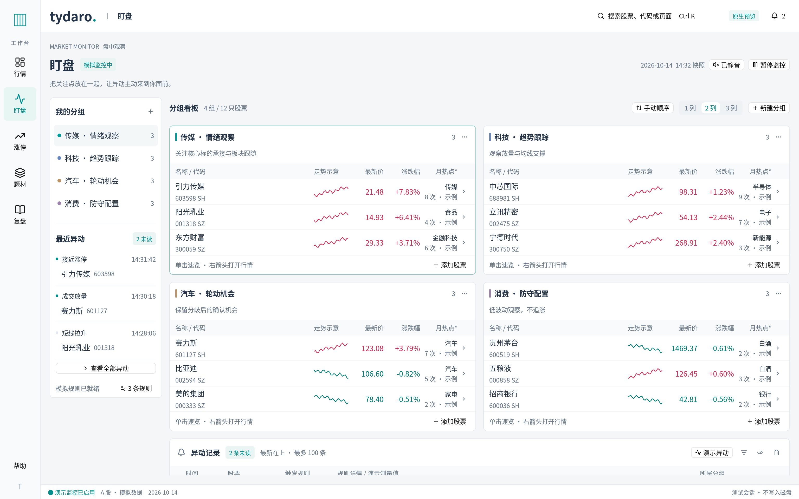

# 五页工作台的 GPUI 实现

本阶段将 [React 设计预览](design-preview.md) 的五页任务结构、浅色与青绿色视觉和主要操作链路实现为 Rust + GPUI 原生界面。应用不嵌入网页；行情继续使用原生图表、DockArea、看板及跨窗口组件能力。Windows 是首要交付平台，Linux 用于构建和离屏交互验证。

原生离屏截图：[行情](native-design/market.png) · [盯盘](native-design/watch.png) · [涨停](native-design/limit.png) · [题材](native-design/theme.png) · [复盘](native-design/journal.png)。截图使用本地模拟数据，窗口逻辑尺寸为 1536×960，按测试显示器的 2× DPI 绘制。



## 页面与交互

| 页面 | 原生布局与已接入的操作 |
| --- | --- |
| 行情 | 保留看板栏、股票列表、图表和盘口。组件新增先打开独立窗口，可回插、关闭和撤销；已有组件身份、选股、周期及内容随页面切换保留。 |
| 盯盘 | 左侧分组导航、规则与最近异动，右侧股票分组和异动记录。支持新建、改名、增删成员、独立排序、列数选择及分组删除确认；窄窗口减少实际列数。 |
| 涨停 | 上方条件、多日板块矩阵、下方明细和搜索结果。支持字段文本的 AND 条件、移除/清空条件、结果定位、复制代码、示例导入、逐条编辑及整日删除/撤销。 |
| 题材 | 对象、周期证据、截止日联动分栏；窄窗口将证据和联动改为页签。提供四板周期、梯队次数、归属、八日关键词及个股速览入口。 |
| 复盘 | 人工热点、按日预案/草稿和笔记、历史日期及手工买入记录。编辑抽屉同时展示买入和卖出条件，阅读窗口是独立原生窗口。 |

统一导航保持五个业务页面；行情看板继续属于行情页。`Ctrl+K` 搜索本地股票或页面，个股速览可查看原生分时/日 K，再打开行情、加入盯盘或引用复盘。编辑期间不以全局搜索跳离尚未关闭的编辑界面。

视觉参数集中在 `src/desktop_ui.rs`。主正文以 14 px 为基准，说明和代码通常为 12 px；白色内容面板、淡灰背景、低对比边界区分层级。青绿色用于主要操作及选中状态，红涨绿跌使用更深的文字颜色。页面按各自任务组织，不要求五页都使用同一种分栏。中文字体、不同 DPI 的点击区域与真实窗口行为仍需原生平台验收。

## 跨页操作的边界

1. **加入盯盘**先显示来源和目标分组，预览新增/重复数量；确认后只追加该组缺少的股票。全部重复时禁用追加按钮。盯盘分组与行情的股票列表组件保持独立。
2. **引用复盘**显示资料来源，允许另选复盘业务日期，确认后建立独立草稿。来源日期不被目标日期替换；不会覆盖已有草稿、自动填写买卖条件或直接生成完整预案。
3. **研究题材**携带涨停资料的日期、板块及股票上下文。请求截止日和实际可用日分别展示；没有符合范围的对象时呈现空状态，不偷换成未来资料。
4. **打开行情**使用现有股票联动路径。仅切换五个业务页面不销毁当前行情的 DockArea 或面板。
5. **关闭窗口**根据对象区分：行情组件浮窗关闭仍删除其中组件并允许布局撤销；复盘阅读窗口关闭只结束阅读视图，不删除业务记录。

## 复盘文档与原生多窗口

预案要求板块非空，至少买入或卖出一侧同时填写方法和触发条件。允许只写卖出预案；只要某一侧填写了内容，该侧就必须补齐必要条件才能提交。不完整内容作为独立草稿保留，输入修改同步到草稿；切换日期和重新打开编辑器不以单个全局草稿覆盖其他日期。

编辑现有预案保留记录 ID，保存更新原条目。阅读窗口与主窗口读取同一业务文档，但分别创建 InputState、焦点和滚动状态。每个阅读窗口固定其打开时的日期；主页面随后切换日期，不会改变阅读窗口笔记的写入目标。关闭阅读窗口不触发记录删除。

人工热点、买卖方法词库和手工买入记录分别维护。人工热点上限为五条；手工买入简介先取按日期排序的最近十笔，再按手工收益率排序，严格超过 10% 才高亮。该收益率不代表真实账户绩效，修改这些记录也不会下单或变更模拟持仓。

## 存储与兼容

| 文件 | 保存范围与兼容原则 |
| --- | --- |
| `workspace.json` | 继续使用既有看板和布局格式；保存行情面板身份、股票列表、布局及浮窗，不用新业务数据替换旧布局。 |
| `desktop.json` | 新增版本化业务文档，保存活动页面、盯盘分组/监控偏好/规则/异动、复盘文档与涨停资料编辑。与布局文档分开。 |

两个文件都位于平台应用数据目录，可通过 `TYDARO_DATA_DIR` 隔离。业务文档由应用级状态统一调度防抖保存；成功落盘才更新成功状态。读取失败、未知版本或外部文件变化时保护原文件并显示原因，不能把内存初始样例静默覆盖到用户文档。当前没有导入 React `localStorage` 或旧 WPF 数据库的迁移功能。

页面实体保留各自选择、筛选与滚动状态；这些视图状态不都持久化到业务文档。复盘阅读窗口不属于行情 DockArea，也不写入看板浮窗快照，重启后需重新打开。

## 本阶段的数据范围

所有行情和研究仍使用本地模拟数据。原生股票目录扩展到十二只 A 股及既有美港股，保留旧 Symbol 序列化名称；已有股票列表不因目录扩充自动追加成员。

涨停“导入”载入内置示例日，当前不是文件选择、旧格式兼容解析、SHA-256 去重或数据库导入。资料增删改可以本地保存，但不触发题材算法重算。题材的四板对象、归属、累计次数、八日关键词与联动均为可解释的固定样例，不能作为旧系统算法一致性的证据。

盯盘监控开关为全局状态，切页保留；“演示异动”按当前启用规则产生一条明确标注的演示事件。暂停阻止生成新事件，全部已读保留记录，清除只移除已读记录。静音仅保存偏好，本阶段不播放声音。没有真实行情轮询、十五秒规则采样、有效性检查、冷却/每日计次、声音队列或 Windows SAPI。

新页面使用任务固定布局，尚未将每一块研究或复盘内容变成任意停靠组件。行情页原有自由布局仍可使用。后端、真实交易、CLI、旧数据库迁移和完整研究算法均不在本阶段范围。

## 代码与验收入口

| 文件 | 职责 |
| --- | --- |
| `src/desktop.rs` | 统一外壳、五页导航、全局搜索、个股速览及跨页确认 |
| `src/desktop_ui.rs` | 共用颜色、标题、面板和标签样式 |
| `src/desktop_state.rs` | 业务模型、输入约束、状态更新及版本化持久化 |
| `src/watch_page.rs` | 分组、规则、演示异动及监控界面 |
| `src/research_page.rs` | 涨停资料与题材研究页面 |
| `src/journal_page.rs` | 复盘编辑、历史、方法词库及原生阅读窗口 |
| `src/desktop_smoke.rs` | 五页实际绘制、指针/键盘输入和生产状态断言 |

沿用 Rust 1.96.0、锁文件及 [开发检查矩阵](development.md)。原生 smoke 入口保持不变：

```bash
cargo run --locked --features test-support --bin tydaro -- --smoke-test artifacts/tydaro-linux.png
```

只迭代五页交互时可运行 `--desktop-smoke-test artifacts/tydaro-desktop.png`，它使用同一个真实原生初始化和五页回归，省去前置的旧行情/布局场景。最终交付仍运行完整 `--smoke-test`，不能用专用入口替代既有回归。

新回归在旧行情/布局回归之后运行，实际点击导航、输入框、分组和研究操作，不以一套测试页面替代生产 UI。输出五页的 1536×960、1280×800 逻辑像素窗口截图及独立阅读窗口截图；PNG 像素尺寸随实际 DPI 比例放大。文件后缀为 `-desktop-{page}-{width}.png` 和 `-desktop-journal-reading.png`。验证结果应以当次命令和 CI 日志为准；截图、自动交互、Windows 构建和 Windows 实机验收须分别记录。

Windows 人工验收重点：100%、125%、150%、200% 字体/DPI，中文 IME 候选确认和取消，编辑抽屉滚动，阅读窗口的输入/焦点及固定日期，行情浮窗跨屏回插，以及业务文件写入失败/重启恢复。当前文档不将尚未执行的 Windows 实机检查记为通过。

## 本阶段本地验证（2026-10-16）

- `cargo fmt --all -- --check`、`cargo clippy --locked --all-targets --features test-support -- -D warnings` 和默认功能的 `cargo check --locked` 通过。
- `cargo test --locked --all-targets --features test-support`：103 项通过，0 项失败。
- `cargo run --locked --features test-support --bin tydaro -- --desktop-smoke-test artifacts/tydaro-final.png` 完成并返回 0。五页在 1536×960、1280×800 逻辑尺寸完成实际绘制、点击和输入回归，生成十张页面截图及一张独立阅读窗口截图。
- 交互回归覆盖行情面板身份保留、图表获得焦点后的全局搜索、盯盘分组和异动、研究筛选与确认后去重追加、来源日期与业务日期分离、独立草稿、仅卖出预案、按 ID 更新、主窗口笔记输入及阅读窗口同步、阅读窗口固定日期与关闭保留数据。

本文五张页面截图来自上述最终原生回归。当前记录不代表完整组合 `--smoke-test` 或 Windows 实机验收完成；完整回归和 Windows 构建结果以对应运行日志及 [GitHub Actions](https://github.com/Naza3/tydaro/actions) 为准。
